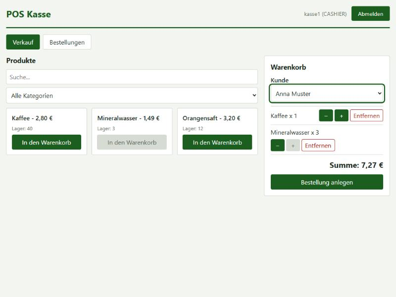

# POS Application

[](https://github.com/Albatros46/POS_Application/actions/workflows/ci.yml)




## What it is

A point-of-sale application with a Spring Boot REST API and a German React till UI. A cashier logs in, puts products in a cart, creates an order, takes the payment or cancels it.

## Features

| Area | Feature |
| --- | --- |
| Authentication | Login with JWT, role-based access (ADMIN, CASHIER), user registration by an admin |
| Products | Create, list, update and delete products; each product belongs to a category |
| Categories | Create, list, update and delete categories |
| Inventory | Stock quantity per product |
| Customers | Create, list and update customers; admin can delete them; list the orders of a customer |
| Sales | Cart with quantities limited to stock, order creation, order cancellation |
| Payments | Record a payment for an open order; the amount must equal the order total |
| Orders | List all orders with their status, total and items |
| Till UI | Product search and category filter, customer selection, order list with pay and cancel actions |

## Business rules

- Stock is checked and reduced inside one transaction, with a pessimistic row lock on the inventory rows.
- Locks are taken in ascending product id order, so concurrent orders cannot deadlock.
- The unit price is stored on each order item, so later price changes do not alter existing orders.
- A payment must equal the order total exactly.
- Only OPEN orders can be paid or cancelled.
- Cancelling an order restores the stock of its items.
- Order items cannot be changed through the API.
- Customers that have orders cannot be deleted.

## Roles

| Role | Access |
| --- | --- |
| ADMIN | Products, categories, inventory, roles, users, delete customers |
| CASHIER | Read, create and edit customers, orders and payments |

The first admin is created on startup from `ADMIN_USERNAME` and `ADMIN_PASSWORD`. The admin creates cashier accounts through `POST /api/auth/register`.

## API overview

All endpoints are under `/api`. Send the token from `POST /api/auth/login` as `Authorization: Bearer <token>`.

| Area | Endpoints | Required role |
| --- | --- | --- |
| Auth | `POST /auth/login` | Public |
| Auth | `POST /auth/register` | ADMIN |
| Products | `GET /products/getAllProduct`, `GET /products/getByIdProduct/{id}` | ADMIN, CASHIER |
| Products | `POST /products/new-product`, `PUT /products/updateProduct/{id}`, `DELETE /products/delProduct/{id}` | ADMIN |
| Categories | `GET /categories/getAllCategories`, `GET /categories/byIdCategory/{id}` | ADMIN, CASHIER |
| Categories | `POST /categories/new-category`, `PUT /categories/updateCategory/{id}`, `DELETE /categories/delCategory/{id}` | ADMIN |
| Inventories | `GET /inventories/getAllInventories`, `GET /inventories/getByIdInventory/{id}` | ADMIN, CASHIER |
| Inventories | `POST /inventories/new-inventory`, `PUT /inventories/updateInventory/{id}`, `DELETE /inventories/delInventory/{id}` | ADMIN |
| Customers | `GET /customers/getAllCustomer`, `GET /customers/getByIdCustomer/{id}`, `GET /customers/orders/{id}` | ADMIN, CASHIER |
| Customers | `POST /customers/new-customer`, `PUT /customers/updateCustomer/{id}` | ADMIN, CASHIER |
| Customers | `DELETE /customers/delCustomer/{id}` | ADMIN |
| Orders | `POST /orders/new-order`, `POST /orders/{id}/cancel` | ADMIN, CASHIER |
| Orders | `GET /orders/getAllOrders`, `GET /orders/getByIdOrder/{id}`, `GET /orders/customer/{customerId}`, `GET /orders/{orderId}/items` | ADMIN, CASHIER |
| Payments | `POST /payments/new-payment` | ADMIN, CASHIER |
| Payments | `GET /payments/getAllPayments`, `GET /payments/getByIdPayment/{id}` | ADMIN, CASHIER |
| Users | `GET /users/getAllUsers`, `GET /users/getByIdUser/{id}`, `DELETE /users/delUser/{id}` | ADMIN |

Errors have one JSON shape: `{timestamp, status, error, message, path, errors}`. The `errors` array lists field messages for validation failures and is empty for other errors.

## Tests

Run the backend tests from `POS_Application` with `mvn -B test`.

The suite has 55 backend tests. They call the HTTP API with real JWT tokens against an in-memory H2 database.

| Test class | Tests |
| --- | --- |
| AuthFlowTest | 19 |
| OrderFlowTest | 15 |
| PaymentFlowTest | 7 |
| ErrorContractTest | 7 |
| JwtServiceTest | 5 |
| ConcurrencyTest | 1 |
| PosApplicationTests | 1 |
| **Total** | **55** |

The concurrency test sends 8 orders that compete for 5 units of stock. Exactly 5 units are sold.

### Control runs

To check that the tests catch real defects, these changes were made one at a time and the tests were run:

| Change | Result |
| --- | --- |
| Stock not decremented when an order is placed | OrderFlowTest: 5 failures |
| Pessimistic lock removed | ConcurrencyTest red |
| Payment amount check disabled | PaymentFlowTest red (409 expected, 201 received) |
| `/api/users` opened to cashiers | AuthFlowTest red (403 expected, 200 received) |
| Transaction removed from the order service | OrderFlowTest: 10 failures |

### End-to-end check

Login, sale, payment and cancellation were run by hand in the browser against a real PostgreSQL 16 database.

## Run it locally

Requirements: Java 21, Maven (or the included `mvnw` wrapper), Node.js 22, Docker.

1. Start PostgreSQL. `DB_PASSWORD` must be set, otherwise Compose stops with an error.

   ```bash
   export DB_PASSWORD=<your-db-password>
   docker compose up -d
   ```

2. Give the backend its secrets. The simplest way, also for running `PosApplication` from an IDE, is a local file that Git ignores:

   ```bash
   cp POS_Application/config/local.properties.example POS_Application/config/local.properties
   # then fill in the database password, a JWT secret and the first admin password
   ```

   Environment variables override this file. Without either, the start fails with `Could not resolve placeholder 'JWT_SECRET'`.

   Alternatively, set the backend environment variables in the shell that runs Maven. Spring Boot does not read the `.env` file by itself. See `.env.example` for all variables.

   PowerShell:

   ```powershell
   $env:DB_PASSWORD = "<your-db-password>"
   $env:JWT_SECRET = "<at-least-32-bytes>"
   $env:ADMIN_PASSWORD = "<initial-admin-password>"
   ```

   Bash:

   ```bash
   export DB_PASSWORD="<your-db-password>"
   export JWT_SECRET="<at-least-32-bytes>"
   export ADMIN_PASSWORD="<initial-admin-password>"
   ```

   `JWT_SECRET` must be at least 32 bytes. On bash, `openssl rand -hex 32` produces a suitable value.

3. Start the backend on port 7070:

   ```bash
   cd POS_Application
   mvn spring-boot:run
   ```

4. In a second terminal, start the frontend on port 5173. Vite proxies `/api` to the backend.

   ```bash
   cd POS_Frontend
   npm ci
   npm run dev
   ```

Open http://localhost:5173 and log in with `ADMIN_USERNAME` and `ADMIN_PASSWORD`.

## Upgrading an existing database

`spring.jpa.hibernate.ddl-auto=update` does not change existing `double` columns to `numeric`. It also cannot add the new NOT NULL columns `orders.status`, `orders.total_amount` and `order_items.unit_price` to tables that already contain rows. Migrate such a database by hand, or start with an empty database.

## Known limits

- No Flyway migrations yet.
- No refresh tokens.
- A token stays valid until it expires, even after a password change.
- No login rate limit.
- No payment provider: a payment is recorded, not processed.
- API messages are in English, the UI is in German.
- The UI has no automated tests yet.

## Project structure

```
.github/workflows/ci.yml      CI: backend tests, frontend lint and build
docker-compose.yml            PostgreSQL 16 for local development
.env.example                  Environment variable template (placeholders only)
docs/pos-sale.jpg             Screenshot of the sales screen
POS_Application/              Spring Boot backend (Java 21, Maven)
  src/main/java/com/sakcadag/
    controller/               REST controllers
    service/                  Service interfaces and implementations
    entity/                   JPA entities
    respository/              Spring Data repositories
    security/                 JWT, security configuration, initial admin
    dto/                      Request and response types
    exception/                Business exceptions and the error handler
  src/test/                   Tests (H2, test profile)
POS_Frontend/                 React 19 and Vite till UI (German)
  src/components/             Login form, product grid, cart, order list
```
